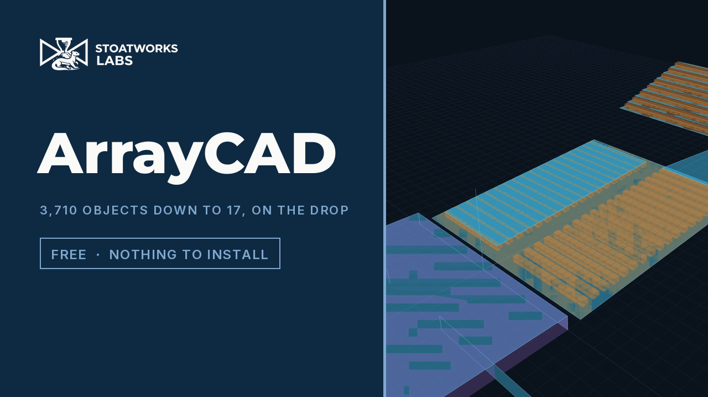
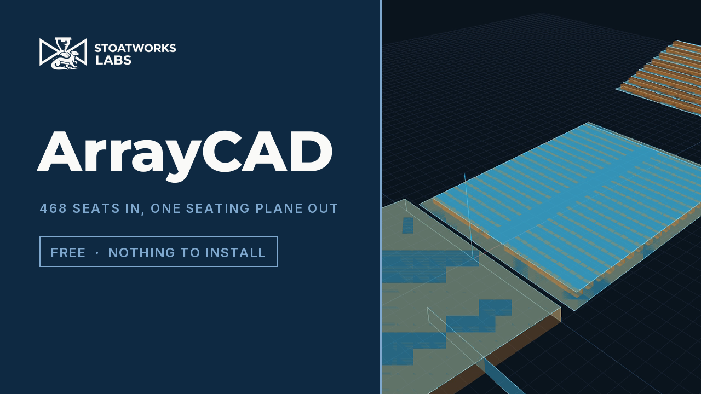
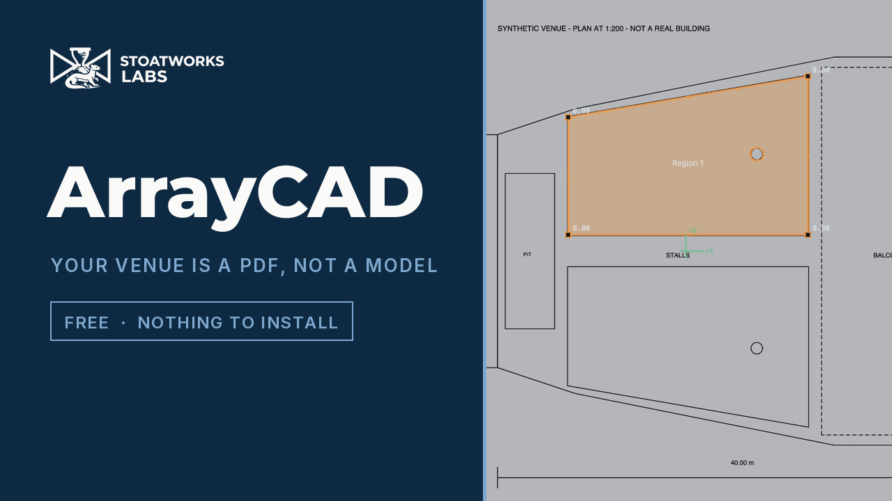

# ArrayCAD

> **AI-assisted project.** This codebase was created with [Claude Code](https://claude.com/claude-code)
> (Anthropic), directed and reviewed by a human author. I've checked the geometry against the
> applications themselves rather than against a description of them. A `.dbacv` it writes
> reproduces a real ArrayCalc export byte for byte and has been round-tripped through ArrayCalc
> until every object came back untouched, Soundvision 3.18.0.15 imported a written `.txt` and read
> it back surface by surface, and EASE Focus 3.1.260 opened and saved a project of 57 audience
> planes with all 57 labels and every coordinate intact. 515 tests pin the reduction, and 38 more
> check it against four real venues' own published drawings. What none of
> that proves is **acoustic orientation**. No prediction has been run over an imported surface
> yet, and a surface wound the wrong way lands right where it should and then silently returns no
> mapping result, so check a mapping before you trust a whole design to it.

ArrayCAD turns a CAD venue model into a d&b ArrayCalc venue file.

Drop in a DWG, DXF, glTF, IFC, OBJ or something similar. ArrayCAD merges the model's triangles
back into flat planes, lets you bin everything ArrayCalc doesn't need, lets you say what each
surface *is* (listening, surface, stage) and writes a `.dbacv`.

It does L-Acoustics Soundvision too. The same reduced venue exports as Soundvision *3D room
data* (`.txt`), the format its own SketchUp and Vectorworks plug-ins write. See
[Soundvision](#soundvision).

And AFMG EASE Focus 3 (`.fc3`). EASE Focus has no geometry import at all (you type coordinates
or trace over a picture), so writing the project file is the only way in. See
[EASE Focus](#ease-focus).

All three formats open as well, so ArrayCAD converts between the three prediction tools: drop
any one in, write any other. See
[Converting between the prediction tools](#converting-between-the-prediction-tools).

No 3D model? Trace one off the plan. Drop in a PDF or an image instead, set the scale, click
inside a room to detect its outline and type a height at each corner. See
[Tracing a plan](#tracing-a-plan).

Every seat modelled separately? Select them or draw round them, and swap the lot for the one
seating plane they stand for. See
[Rationalising a seat-by-seat plan](#rationalising-a-seat-by-seat-plan).

Most of that happens as the file opens. Clutter gets left out, plane types are read off the
names, banks of seats are flattened and meshed surfaces re-cut, and a model that arrives as one
lump with no names at all is taken apart by its shape. You can see every bit of it and put any
of it back with one click. See [Preparing a model on import](#preparing-a-model-on-import).

It runs entirely in the browser. There's no backend and no upload, so the file never
leaves your machine.

**[Try it →](https://arraycad.stoatworks-labs.com)**

### Watch

[](https://www.youtube.com/watch?v=HZ3ln72t0HA)

**[3,710 objects down to 17, on the drop →](https://www.youtube.com/watch?v=HZ3ln72t0HA)**:
what the layer names already tell it, read as the file opens. The box gets unticked on camera,
because you can't see work that's already been done for you, but you can watch it being undone.

| | |
|---|---|
| [](https://www.youtube.com/watch?v=HFZKeIwCB5k) | [](https://www.youtube.com/watch?v=Ky7lkRAa8qE) |
| **[468 seats into one seating plane →](https://www.youtube.com/watch?v=HFZKeIwCB5k)** — doing it by hand, and why it is an assertion | **[Trace a venue off the plan →](https://www.youtube.com/watch?v=Ky7lkRAa8qE)** — no 3D model needed |

**[ArrayCalc *and* Soundvision →](https://www.youtube.com/watch?v=w2-KEFSz1Mk)**: one
reduction, two formats.

**[The original 50-second tour →](https://www.youtube.com/watch?v=g5TH-Y7cWNs)**: a CAD
model in, flat planes out.

---

## Why it is not just a file conversion

An ArrayCalc venue is a few dozen parametric planes. A CAD export of the same theatre is tens
of thousands of triangles, and if you hand ArrayCalc the triangles you get a file it can't do
anything useful with.

So the interesting part is the reduction:

```
import  →  weld  →  coplanar regions  →  outline  →  simplify  →  quads/triangles  →  .dbacv
```

A whole raked seating deck is one plane, however many triangles the CAD model spent on it, and
a 12-triangle box is six. Most of what ArrayCAD does is that collapse.

There's one thing the reduction can't do, because it only merges surfaces that touch. If the
plan models every seat on its own (which architects' models do all the time), then four hundred
seats really are four hundred separate surfaces. No tolerance setting will merge them, since the
gap between two seats isn't a crack to be closed. The demo file for this imports as 3,710
ArrayCalc objects, which is a lot of objects for one room.

**Rationalise** sorts that out: select the seats, or draw round them, and replace the lot with
the one plane they stand for. See [Rationalising a seat-by-seat
plan](#rationalising-a-seat-by-seat-plan). ArrayCAD will also offer to do it for you on import;
see [Preparing a model on import](#preparing-a-model-on-import).

## Supported inputs

| Format | Notes |
|---|---|
| **DXF** | Best for venue drawings. 3DFACE, polyface meshes, LWPOLYLINE (including bulges), SOLID, CIRCLE/ARC, ELLIPSE, SPLINE, INSERT blocks including row/column arrays, and **3DSOLID** (truss) as its outer volume — read from the ACIS body in an R2000–R2004 DXF. Reads `$INSUNITS`. Loose lines and arcs are **joined back into closed outlines**, which is what makes an ordinary 2D plan usable; closed outlines can then be extruded to a height. |
| **DWG** | AutoCAD's own format, read directly — no export step, no converter. R13 through R2018. Same entity support and the same outline-joining as DXF. 3DSOLIDs (truss) are read from DWG 2004; the DWG reader currently loses most of them from an R2018 file, and the import says so — save as DWG 2004 or DXF 2004. |
| **glTF / GLB** | Best of the mesh formats — keeps object names and hierarchy, and declares metres and Y-up, so nothing has to be guessed. |
| **IFC** | The only format carrying real semantics. `IfcSlab`, `IfcCovering`, `IfcWall` etc. are mapped to *suggested* plane types. |
| **MVR** | A whole show from a lighting visualiser — Capture, Depence, Vectorworks, WYSIWYG, grandMA3. Layers and classes arrive as the tree; truss, fixtures and supports are tagged by their MVR type, so the rig prunes itself whatever it was named. Millimetres and Z-up are stated by the format, so nothing is guessed. See [the format notes](docs/mvr-format.md). |
| **FBX, Collada, 3DS** | Keep names and hierarchy. |
| **OBJ, PLY, STL** | Geometry only. STL has no names at all, so the whole model arrives as one node. |
| **`.dbacv`** | An existing ArrayCalc venue, for pruning, retyping and converting to Soundvision. See the caveat below. |
| **Soundvision `.txt`** | An existing 3D room data export, for the same — and for converting to `.dbacv`. Surfaces are grouped by their label, which is your CAD layer name. |
| **EASE Focus `.fc3`** | An existing EASE Focus 3 project. Audience zones arrive as raked planes, one object per profile segment. `.fc2` must be re-saved as `.fc3` in EASE Focus first. |
| **PDF** | Not a model — a drawing. Opens the tracer. A vector PDF also gives its real drawn lines to snap to. |
| **PNG, JPEG, WebP, GIF, BMP** | A scan or a photo of a plan. Opens the tracer; outlines are recovered from the pixels. |

### Formats that need an export step first

`.vwx`, `.skp`, `.rvt`, `.3dm`, `.max` and `.blend` are closed binary formats with no public
specification. Nothing outside their own application can read them, and no amount of work on
my end changes that. Drop one in and ArrayCAD tells you which export to run instead. For
Vectorworks that's glTF first, then IFC, then DXF 3D.

DWG has no public specification either, but enough of it has been reverse-engineered that
ArrayCAD reads it directly, so it's the one format on that list that doesn't need an export
step any more.

Lighting visualisers (Capture, Depence, WYSIWYG, grandMA3) are the same story with a happier
ending. Their project formats are closed, but they all read and write MVR, which is an open
standard, and ArrayCAD reads that directly. Export MVR from whichever one you use and drop it
in. Capture can also export glTF or DWG, and those work too.

MVR goes the other way as well (see Going back to the visualiser, below), so a room can come
from a visualiser, get pruned and simplified here, and go back.

## Tracing a plan

Most venues that need a design have a plan rather than a model. A PDF or an image opens a
tracer instead of the reducer, and the rest of the app carries on as normal: a traced region
becomes the same intermediate geometry a CAD import produces, so it goes through the same
conversion, the same inspector and the same writer.

Try it on **[`demo/demo-plan.pdf`](demo/demo-plan.pdf)**, a made-up 1:200 venue with a stage,
a pit, two raked stalls blocks, columns and a balcony.

1. **Set the scale.** A drawing has no units. Either click each end of a dimension you
   know and type its real length, or, on a vector PDF, type the paper scale from the
   title block (`1:200`) and get an exact answer without clicking at all. Measure across
   the *longest* dimension on the sheet: your click accuracy stays the same, so spreading
   it over a longer line makes the error smaller.
2. **Set the origin** if you want it somewhere particular. Venue +X runs right across the
   sheet and +Y up it; **Heading** under Placement aims the room down +X afterwards.
3. **Get the outlines.** *Detect region* floods the enclosed area under the cursor and
   returns its outline. Anything enclosed *inside* it (a column, but on a real plot far
   more often a label, a loudspeaker symbol or a desk) is left out by default and counted
   in the status line; set **Holes** to *Keep* under Detection, with a size floor, when
   the columns matter. If the outline comes back with dozens of corners (a hall with
   pilasters, a wall with every door frame drawn), raise **Outline detail** under
   Detection so anything shallower than that is smoothed out of the walls, or set the
   region's **Fit** to *Rectangle* or *Hull*: the same area as four corners or a convex
   shape, holes dropped, heights carried across as a plane. *As detected* brings the
   outline back. For a hole that shouldn't be there, alt-click inside it, or use *Remove
   holes* for all of them. *Trace* draws one corner by corner, snapping to the drawing's
   own lines. Drag corners to adjust, alt-click one to delete it, click a midpoint to add
   one.
4. **Type the heights.** Every corner carries its own height in metres, so a level floor,
   a raked block, a raised balcony and a sunken pit (negative) are all the same job.
   Past a dozen corners the table folds away in favour of *Set all* and *Ramp*; expand it
   if you do want a number for every corner.
   *Ramp* does the arithmetic: pick a front corner and a back corner, give each a height,
   and the rest follow the slope.

### A DXF or DWG plan

A rig plot or a floor plan saved as CAD is a drawing, not a model: every line at height zero.
Converted as a model it comes out with every surface lying on the floor, the ceiling coffers
included. When that's what's left once the clutter is out, the **Prepare** panel says so and
offers **Trace this plan**, which puts the drawing's own lines on the sheet:

- **No scale to set.** The drawing states its units (`$INSUNITS`), so the sheet is calibrated
  exactly, and the venue origin is the drawing's own 0, 0. If it states none, the Source units
  setting stands in, and the Scale panel says to check it.
- **Only the layers left in are drawn**, so a centreline, the dimensions or the lighting don't
  cut a room in two for *Detect region*. Turn a layer off in the tree first to keep it off the
  sheet too.
- **Snapping uses the real lines**, like a vector PDF.

A plan whose lines never close into a single surface skips the question and opens in the tracer
straight away. Try it on **[`demo/demo-rigplot.dxf`](demo/demo-rigplot.dxf)**.

### Two ways to read the heights

| | |
|---|---|
| **Single plane** *(default)* | Fits one flat plane through the typed heights and puts every corner on it. Always **one** ArrayCalc object. A level floor and a constant rake are both exact; anything else is moved, and you are told by how much. |
| **Exactly as typed** | Uses the heights as they are. Right for a genuinely stepped or dished surface, but the result is not flat, so it comes out as several ArrayCalc objects. |

### What tracing cannot do for you

- **Accuracy is the scale you set.** A dimension misread by 5% makes the whole venue 5%
  wrong, and nothing downstream can tell. Check a second known dimension afterwards.
- **A raster plan is only as good as its render.** Pages are rasterised to 2400 px on the
  long edge, so on an A1 sheet one pixel is about 25 mm of building. Vector PDFs snap to
  the actual lines and don't have this limit.
- **Region detect needs the area to be closed.** A doorway, a dashed balcony edge or a
  broken hairline lets the fill escape. It tells you when that happens rather than silently
  handing back the whole page. Raise *thicken lines* to bridge small gaps, or trace it by
  hand. On a CAD plot, tick **Ignore coloured lines** so a cable run or a dimension drawn
  in colour across the room doesn't cut it in two. The architecture is black and the
  annotation usually isn't, and where a coloured line crosses a wall the wall stays closed.
- **Seat rows seal a room.** On a plan with the seating drawn in, a flood fill stops at the
  first row. Trace the block outline instead; it's four clicks.

## Preparing a model on import

Most of the first ten minutes with a new file goes on work the drawing already describes. The
**Prepare** panel does it as the file opens, and every part of it is a decision you can see
and undo. Nothing is deleted: the objects it leaves out stay in the tree, ghosted in the view,
one click from coming back.

| | |
|---|---|
| **Leave out clutter** | Objects named as something other than a room surface: dimensions, text, lighting bars, truss, cable, ductwork, furniture, people — and modelled loudspeakers, since ArrayCalc and Soundvision place their own. Whole words only, so `TEXTURED PANEL` stays and `TEXT` goes. |
| **Leave out tiny objects** | Brackets, fixings, trim and stray facets, under a surface area you set. Seating is exempt: a seat pan is 0.2 m². |
| **Split one-piece models** | An OBJ, an STL or a media server's stock stage is one mesh with no names to prune by. It's read by its shape instead: rows of treads and risers become **rakes**, cut into sectors wherever one plane stops fitting (a fan into narrower fans, a bowl into its sides and corners, a balcony away from the stalls it overhangs), and the rest goes into **Floor**, **Ceiling** and **Walls**. Each is a row in the tree. |
| **Flatten seating into audience planes** | Banks of seats become the plane they stand for — the same thing the Rationalise panel does by hand, and editable there afterwards. Found by name, by repetition (hundreds of alike, small, upward-facing objects a metre apart are a bank of chairs whatever they are called) and by shape: every rake the split found. Tiers separated in height become separate planes. |
| **Guess plane types from names and shape** | `STAGE` becomes a stage, `WALL` and `CEILING` become surfaces. An object whose name says nothing becomes a surface if it's all wall, or level with the room under it and nothing to stand on above. |
| **Re-cut heavy objects** | A meshed flat wall is hundreds of triangles describing one rectangle. Re-cutting it from its own outline gives the same shape with a fraction of the triangles — a faster viewport and a faster conversion. Anything not genuinely flat, or with a hole in it, is left alone. |

The panel then tells you what it actually did to *your* model, with counts. On
`demo/demo-venue.dxf` that's 3,206 triangles down to 1,322, the lighting bars left out and the
balcony seating flattened: **116 ArrayCalc objects become 52** before you've touched anything.
On `demo/demo-seats.dxf`, the seat-by-seat plan, it's **3,710 objects down to 17**. On
`demo/demo-onepiece.obj`, a theatre as one Y-up mesh with a stepped fan of stalls and a balcony
over them, it's **439 down to 26**: three rakes, the floor, the ceiling and the walls.

Untick a box and it re-runs from the file as imported. It reads the model once, when it opens,
using the units in force at that point, so if the unit guess was wrong, fix it and re-run.

A format that doesn't say which way is up (OBJ, STL, PLY, 3DS) gets that read off the model too:
the axis its largest surfaces face along is the vertical one. It's a guess, and the Source
units panel says so. A DWG or DXF whose seats disagree with the units it states gets a warning
rather than a quiet change. A row of seats is half a metre a seat in every theatre in the
world, and the National Taichung Theater's published plans, which say millimetres and are drawn
in centimetres, are how I know that's worth checking.

## Rationalising a seat-by-seat plan

An architect's model draws every seat. A sound designer wants the seating *area*. The
**Rationalise** panel turns the first into the second.

Pick what to gather up, whichever way suits the drawing:

- **Select in the tree**: right when each seat, or each block, is its own object, as in a
  glTF or IFC export.
- **Box select**: drag a rectangle in the 3D view over the objects you want.
- **Draw an area**: click the corners of the region in the view. This is the one that
  matters for a DXF or DWG, where the whole house is usually on one layer and no amount of
  pruning in the tree will separate the stalls from the balcony.

Then it fits a single plane through what it captured and gives you its outline.

Two settings decide most of the result:

- **Capture**: *Upward faces* (the default) keeps only surfaces pointing up, so a modelled
  seat reduces to its pan rather than dragging the plane down inside the seat. *All faces*
  is for a wall or a bare rake.
- **Outline**: *Follow* traces the seating and bridges gaps up to a distance you set. Set
  it to the row pitch and it joins seat to seat and row to row, and leaves an aisle wider
  than the pitch standing as an aisle. *Hull* is the convex hull, fine for a rectangular
  block and wrong for a horseshoe. *Rectangle* squares it off, which a Positioning area
  has to be.

**Combine the tree and the drawing.** If you select the seating layer first and then draw,
only the seating inside your outline is captured. Draw with nothing selected and it takes
everything under the polygon, including the floor beneath the seats, which fits the plane
half a seat height too low. The panel says which it's about to do.

### Read the numbers underneath

Every area reports what the reduction cost, because "these four hundred seats are one
surface" is your assertion and not the geometry's:

```
432 of 5,184 triangles
46.7 m² of surface → 129.4 m² 
up to 0.02 m off plane
```

The first line is how much got through the capture filter. The second is the actual seat
surface against the area it now stands for. That should be much larger, since the air between
the seats is the point, but wildly larger usually means two blocks got caught in one go. The
third line is the one to watch. A smooth rake reads a centimetre or two, and a rake modelled as
steps reads half a tread, which is expected. Metres means you've caught two tiers and should
rationalise them separately, and it'll tell you so.

Separate areas stay separate. Two blocks either side of a gangway come back as two planes with
a note saying nothing bridged them, rather than one plane paved across the traffic route.

**Replace the originals** is on for a tree selection and off for a drawn area, since a drawn
area usually covers only part of a layer. Turn it off to see the new plane and the seats it
came from together before you commit.

Nothing here edits the model. A rationalisation is a decision, worked out again from the source
geometry every time, so if you change the units afterwards it moves with the room, and if you
delete it the seats come back.

Try it on `demo/demo-seats.dxf` (regenerate with `python3 scripts/make_demo_seats.py`):
3,710 objects without it, 16 once both seating blocks are rationalised, or 17 the moment you
drop the file, since [Prepare](#preparing-a-model-on-import) recognises both blocks by name and
does it for you.

## Vectorworks plug-in

For Vectorworks there's a second route that skips the intermediate file altogether:
**[`vectorworks/`](vectorworks/README.md)** is a Python plug-in that runs inside Vectorworks
and writes `.dbacv` directly.

It can do better than the browser tool, because inside Vectorworks it can see your class
names (which an export throws away) and use them to decide what each object is. It also knows
a few venue-specific tricks the browser tool can't do, like taking just the top face of a
seating solid, or collapsing a lighting bridge to a single ArrayCalc box instead of six quads.

⚠️ **It has never been run inside Vectorworks.** Everything testable without Vectorworks is
tested (80 tests, including the same byte-exact format check), but the one module that calls
the Vectorworks API hasn't been verified. Run its probe script first. See
[vectorworks/README.md](vectorworks/README.md).

## Getting a good result

1. **Export less.** In the CAD tool, export only the classes you need (seating, stage,
   walls, ceiling) and leave lighting, rigging, trussing and dimensions behind. This saves
   more work than anything in this app.
2. **Check the units.** Only glTF and IFC state them, and DXF often says "unitless". The
   app guesses from the model's overall size and tells you when it's guessing. Check it
   against a dimension you know.
3. **Set the datum.** ArrayCalc wants the audience towards **+X**, Y symmetric about zero,
   Z up. Use heading, offset and the mirror toggle; the drawn axes show which way is which.
   For the offset, **Pick in view** next to *Origin* is usually quicker than typing: click
   a point on the model (centre stage, the front edge of the stalls) and it becomes 0, 0,
   0, with the axes moving there. The marker turns blue and snaps when the cursor is near a
   corner, so a corner lands on the corner rather than a millimetre off it, and picking
   works on the converted planes as well as on the source. Esc cancels. Set the **heading**
   before the origin: the room turns about the model's own datum, which carries the picked
   point off zero.
4. **Choose a fit.** *Rectangle* collapses each region to one rectangle, aligned to the
   level direction of its own plane so it can always be written as a single ArrayCalc quad.
   That's one object per region, and usually what you want for seating. *Follow outline*
   is faithful, but a ragged CAD outline turns into lots of objects, and any face that
   isn't a symmetric trapezoid has to be split into two triangles.
5. **Watch the object count.** If it's in the hundreds, raise the merge tolerances, raise
   the minimum area, or switch to rectangle fit.

### Pruning a long object list

You prune a venue by throwing away whole categories, not one object at a time, so the object
tree groups itself:

- **Groups are named after what's in them.** A `.dbacv` names every group after its own
  GUID; ArrayCAD reads a proper name back off the children instead, so a row says `TIER 3`
  rather than `RoomObjectGroup: {c9ab9376-…}`.
- **A flat list gets grouped by name.** A DXF, a DWG or a flat glTF export is one long list
  of siblings, and ArrayCAD clusters it by the structure already in the names, whether the
  category leads (`TIER 3 - LEFT 1`) or trails a number (`25 loge`, `45 loge`).
- **Every group folds away and selects in bulk.** The triangle beside a group hides its
  contents; its checkbox includes or excludes everything under it at once, and shows a dash
  when only some of it is in.
- **Group by** switches between the automatic name grouping, grouping by the **plane type**
  you've assigned (the quickest way to check nothing is mistyped before exporting) and the
  raw tree with no grouping at all.

## The `.dbacv` format

It's undocumented. Everything this tool knows was reverse-engineered from one real ArrayCalc
12.8.2 export plus three round trips through ArrayCalc itself, and it's all written up in
**[docs/dbacv-format.md](docs/dbacv-format.md)**.

The reader and writer reproduce that file **byte for byte**, which is good evidence the
structure is right.

The round trips were worth doing. The first one failed and turned up a real bug: a `Shape=1`
quad has to be written in ArrayCalc's own local frame (origin on the *near edge*, not the
centroid), and getting it wrong makes ArrayCalc silently collapse the plane to zero depth,
sometimes not until weeks later. By the third round every object came back byte-identical, and
that result is pinned as a test. They also settled that `PlaneType 5` is a "Positioning area",
which has to be rectangular, and that a listener height is kept on type 1 but silently reset on
type 2.

> ⚠️ **Some plane-type names are still inferred.** `Positioning area` (5) comes from
> ArrayCalc's own dialog, and `Listening` (1) is near-certain. `Surface` (2) and `Stage`
> (4) are still deductions, and type 3 is a real type whose name is unknown. The app
> always shows the raw numeric code beside the label, because that's what actually gets
> written. Check a converted venue in ArrayCalc before you trust a whole design to it.

### Re-importing a `.dbacv` is lossy

Opening an existing venue tessellates every object into triangles and rebuilds it from planes.
Arc segments and boxes come back as flat quads. Use it to prune and retype, not to preserve.

## Soundvision

**Export .txt**, then in Soundvision: *3D room data → Import 3D room data*.

Soundvision's native scene file (`.xmls`) is encrypted (AES-256-CBC, with a key the application
puts together at runtime), so nothing outside Soundvision can write one. Instead ArrayCAD
writes the format L-Acoustics documents for this very job, the one its own SU4SV (SketchUp) and
Vectorworks plug-ins produce:

> It is possible to import in Soundvision 3D room data `*.txt` files that were exported from
> CAD software, such as SketchUp or Vectorworks.

It's a plain list of labelled, planar polygons, which suits the reduction better than `.dbacv`
does: a Soundvision surface is a free polygon, so a six-sided balcony stays one surface instead
of being split into two triangles to fit ArrayCalc's canonical quad.

Two things to know:

- **The format carries geometry and a label, nothing else.** Audience listening levels, and
  which surfaces are enabled for mapping, are set in Soundvision after importing, which is its
  normal workflow anyway. Faces are labelled with your CAD layer names so you can find them.
- **Winding matters, and getting it wrong is silent.** Soundvision needs surface points
  counter-clockwise. A reversed one isn't an error, it just returns no mapping result.
  ArrayCAD orients every face for you.

The grammar, the evidence behind it and what's still unverified are in
**[docs/soundvision-format.md](docs/soundvision-format.md)**.

### Confirmed inside Soundvision

I imported an ArrayCAD-written file into **Soundvision 3.18.0.15 (2026.2)** on 2026-08-02 and
read it back surface by surface. A 20 × 12 m floor, a rake rising 0 → 3 m, a **six-sided
polygon** and a vertical wall all arrived with the coordinates as written, in order. The hexagon
came in as **one surface of six points**, which is the main reason this target suits the
reduction better than `.dbacv`. Soundvision also strips the ` face` suffix from a label itself,
so names round-trip unchanged.

> ⚠️ **Geometry is confirmed; acoustic orientation is not.** A surface can land in the right
> place and still return no mapping result if it's wound the wrong way. That's the trap
> described above, and nothing warns you about it. ArrayCAD orients every face, but no
> prediction has yet been run over an imported surface to prove it. Check a mapping before you
> trust a whole design to it.

## EASE Focus

**Export .fc3**, then open it in EASE Focus 3 with *File → Open*. There's no import step
because EASE Focus has no geometry import: its own guide offers typed coordinates (including
polar, for a laser-and-inclinometer survey) or a picture to trace over, and nothing else.
Opening the project file is the way in.

The catch is the model. EASE Focus has no surfaces at all. A venue is a set of **audience
zones**, each a plan rectangle with a position, an orientation and a height profile along its
axis. So this export has to properly reduce the venue rather than re-serialise it:

- **Only Listening planes convert.** Walls, ceilings and stages have no equivalent in EASE
  Focus, so leaving them out isn't losing anything. It's the only honest thing to do.
- **Each plane becomes one oriented rectangle** with a single profile segment, front edge
  at the low side, audience facing downslope. Outline detail and holes are lost, because
  the format has nowhere to put them.
- **Zones narrower than 2 m are silently widened to 2 m** by EASE Focus itself, centres
  unmoved, with nothing on screen to say so. Seat-by-seat rows are often narrower than
  that, so ArrayCAD warns you for each zone. [Rationalise](#rationalising-a-seat-by-seat-plan)
  the rows into blocks first and the problem goes away.

The container, the model and the evidence are in
**[docs/ease-focus-format.md](docs/ease-focus-format.md)**.

### Confirmed inside EASE Focus

Checked against **EASE Focus 3.1.260** on 2026-08-03. The 57 audience planes of a real
ArrayCalc theatre export were written as a project, opened, and saved back by the application:
57 zones came back, all 57 labels intact, and every position, orientation, depth and height
identical to what was written. The only change the application made was the 2 m width clamp
above, which is how I found out about it.

## Going back to the visualiser

**Export .mvr** writes the room back out as MVR, for Capture, Depence, WYSIWYG, grandMA3 or
Vectorworks. You get one object per plane, keeping the names you pruned by, with the plane
types as MVR *classes* so the audience areas can be toggled as a set.

It's the only export that **doesn't** reduce. ArrayCalc needs parametric planes and EASE Focus
needs rectangles, but MVR carries glTF, which wants triangles, and the coplanar merge has
already made those. So what arrives is the simplified room: one clean surface where the source
had a thousand facets, and nothing more lost to the format.

> **Not yet confirmed in a visualiser.** The file is a valid MVR 1.4 archive, its geometry
> reads back through three.js's own glTF loader, and an MVR imported → exported →
> re-imported here reproduces the venue dimension for dimension. But nobody has opened one
> in Capture or Depence yet, and MVR doesn't state the units of the 3D files inside it
> (**[docs/mvr-format.md](docs/mvr-format.md)** §5). Check the size after importing.

## Converting between the prediction tools

None of the three applications will open another's venue, so a room modelled for one usually
gets redrawn by hand for the next. That's a day's work, and it also guarantees the predictions
are of subtly different buildings.

ArrayCAD opens all three formats, so converting is just an import and an export:

| You have | Drop it in | Press |
|---|---|---|
| A d&b ArrayCalc venue | `.dbacv` | **Export .txt** → *3D room data → Import 3D room data*, or **Export .fc3** |
| A Soundvision room | 3D room data `.txt` | **Export .dbacv** or **Export .fc3** |
| An EASE Focus project | `.fc3` | **Export .dbacv** or **Export .txt** |
| A visualiser show | `.mvr` from Capture, Depence, WYSIWYG, grandMA3 | any of the three |
| Any of the above | | **Export .mvr**, back into the visualiser |

Nothing special happens in between. The venue takes the same road a CAD model does
(tessellate, weld, merge coplanar regions, recover outlines, write the other format), so you
get the same tree, the same pruning and the same plane typing on the way through.

What that means in practice:

- **It isn't a byte-preserving translation, and shouldn't be.** The two formats don't
  describe the same things. ArrayCalc has boxes and arc segments and plane types;
  Soundvision has free polygons and a label. Going either way, geometry is rebuilt from
  planes; see [Re-importing a `.dbacv` is lossy](#re-importing-a-dbacv-is-lossy).
- **Soundvision → ArrayCalc loses nothing that was there**, because 3D room data carries no
  plane types or listening levels to lose. You set those here, once, on the way through.
- **ArrayCalc → Soundvision keeps more shape than the reverse**, because a Soundvision
  surface is a free polygon while an ArrayCalc quad has to be a symmetric trapezoid.
- **Anything → EASE Focus keeps the least**, because EASE Focus keeps the least: audience
  zones only, each one a rectangle. Convert *out* of EASE Focus and you get precisely the
  audience back (its zones are unambiguous), but nothing that was never in it.
- **Surfaces come in grouped by their label.** L-Acoustics' own plug-ins write
  `"<layer name> face"`, so a room exported from Vectorworks arrives with the CAD layer
  tree intact and ready to prune. The ` face` suffix is stripped on the way in and put back
  on the way out, so a name doesn't grow a word on every trip.

> ⚠️ The Soundvision caveat above applies to this route too: the geometry is confirmed to
> import, but no prediction has yet been run over an imported surface.

## Develop

```bash
npm install
npm run dev
```

```bash
npm test
```

```bash
npm run build
```

See [CLAUDE.md](CLAUDE.md) for the full command reference and [AGENTS.md](AGENTS.md) for the
model, the invariants and the traps.

<!-- selfhost:start -->
## Run your own copy

ArrayCAD is a static page, so hosting it yourself is one container serving
the built files — the same files the hosted copy serves, running somewhere that
still works when the venue has no internet.

**Docker.** The image is built by this repo's `docker.yml` workflow on every
push and published as `ghcr.io/stoatworks-labs/arraycad`:

```bash
docker run -d --name arraycad --restart unless-stopped -p 8523:80 ghcr.io/stoatworks-labs/arraycad:latest
```

Or `docker compose up -d` with the [`docker-compose.yml`](docker-compose.yml)
in this repo, which maps the same port. Either way it is then at
`http://localhost:8523/`.

**Unraid.** Search Community Applications for *ArrayCAD* — the template is
[`templates/arraycad.xml`](https://github.com/stoatworks-labs/stoatworks-unraid/blob/main/templates/arraycad.xml)
in [stoatworks-unraid](https://github.com/stoatworks-labs/stoatworks-unraid), which is what the CA feed reads.

**Stoatworks Burrow** lists it under *Self-hosted*, with the compose file a
click away.

The `Dockerfile`, `docker-compose.yml`, `docker/` and the workflow are
generated from `fleet.json` in stoatworks-unraid. Change them there and
regenerate rather than editing them here.
<!-- selfhost:end -->

<!-- attributions:start -->
This project is built on other people's work — see [ATTRIBUTIONS.md](ATTRIBUTIONS.md).
<!-- attributions:end -->

## Licence

MIT.
